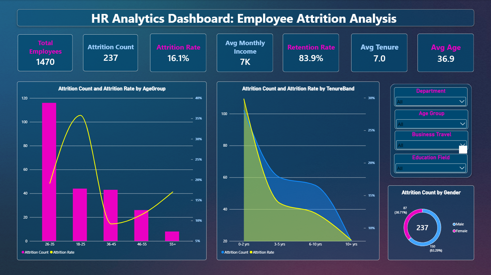
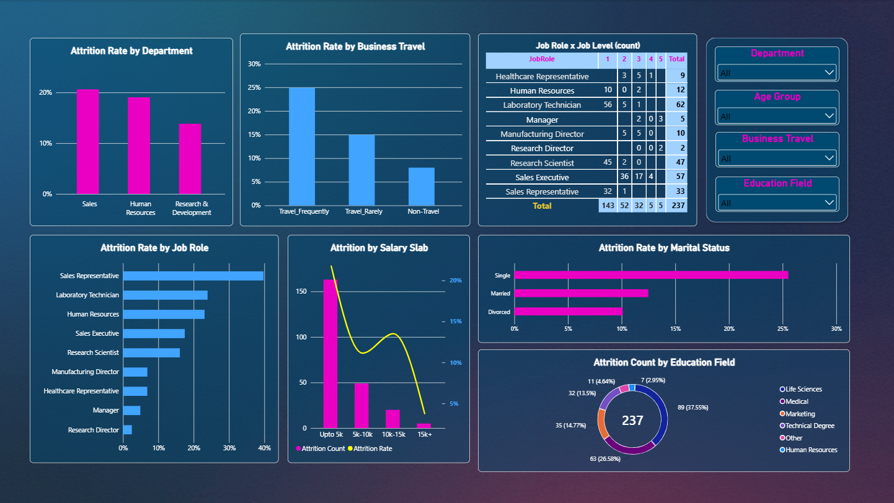
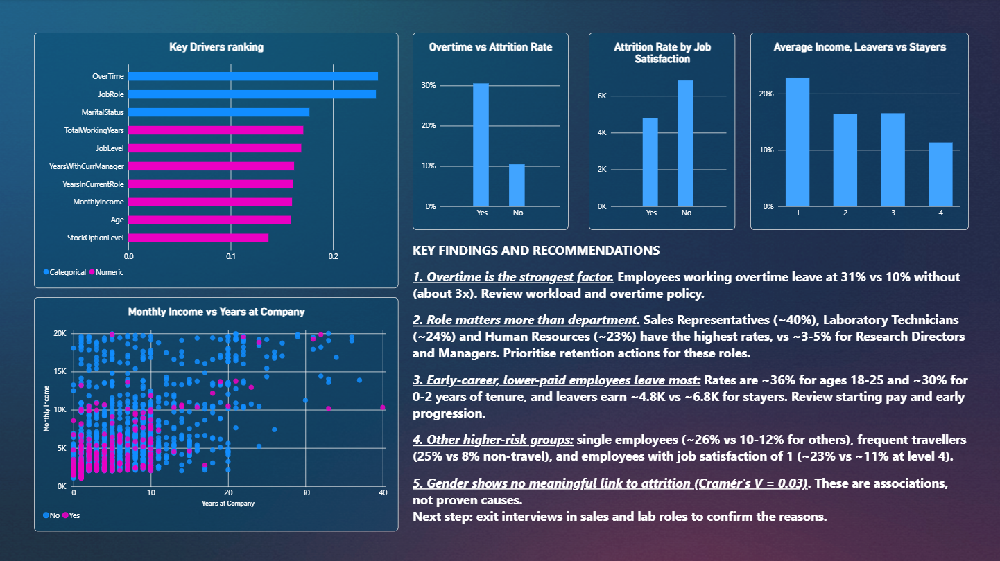

# HR Analytics Dashboard: Employee Attrition Analysis
 
An end-to-end HR analytics project that explores why employees leave, compares attrition across departments and roles, ranks the key factors with a correlation analysis, and presents everything in a 3-page interactive Power BI dashboard built for decision-making.

 > Internship project, Syntecxhub.

---
 
## Table of Contents
 
- [Project Overview](#project-overview)
- [Objectives](#objectives)
- [Dataset](#dataset)
- [Tools and Technologies](#tools-and-technologies)
- [Project Workflow](#project-workflow)
- [Key KPIs](#key-kpis)
- [Dashboard Preview](#dashboard-preview)
- [Key Findings](#key-findings)
- [Recommendations](#recommendations)
- [Limitations](#limitations)
- [Repository Structure](#repository-structure)
- [How to Reproduce](#how-to-reproduce)
- [Author](#author)
---
 
## Project Overview
 
Employee attrition is costly: it means lost knowledge, recruitment and training expenses, and lower team morale. This project analyses an HR dataset of 1,470 employees to answer one question: **which factors are associated with employees leaving, and where should HR act first?**
 
The analysis combines Power BI (cleaning, DAX measures, dashboard) with a Python notebook (correlation analysis and a Random Forest cross-check). The result is a dashboard that moves from a high-level overview to a breakdown by department and role to a ranked view of the key drivers.
 
## Objectives
 
- Analyse the employee dataset (salary, department, experience, and more)
- Identify patterns in employee attrition
- Perform correlation analysis to find the key factors
- Compare attrition across departments and roles
- Build KPIs such as attrition rate and retention rate
- Create an HR dashboard for decision-making
## Dataset
 
- **Source:** [HR Analytics Dataset (Kaggle)](https://www.kaggle.com/datasets/anshika2301/hr-analytics-dataset)
- **Size:** 1,480 rows and 38 columns in the raw file; **1,470 rows** after removing duplicate `EmpID` records
- **Target variable:** `Attrition` (Yes / No)
- **Nature of the data:** synthetic, so findings illustrate the method rather than describe a real company
The raw data is **not stored in this repository**. To run the project, download `HR_Analytics.csv` from the link above and place it in the `data/` folder.
 
## Tools and Technologies
 
| Tool | Use |
|---|---|
| Power BI Desktop | Data loading, cleaning (Power Query), DAX measures, dashboard |
| Power Query | Type checks, duplicate removal, constant-column removal, derived columns |
| DAX | KPI and comparison measures |
| Python (pandas, NumPy, SciPy, scikit-learn) | Correlation analysis, Cramér's V, Random Forest |
| Matplotlib / Seaborn | Notebook charts |
| Jupyter Notebook | Analysis environment |
| Canva | Dashboard background image |
 
## Project Workflow
 
**1. Data loading and cleaning (Power Query)**
- Loaded the CSV and verified data types, blanks, and categorical values
- Removed duplicate `EmpID` rows (1,480 to 1,470)
- Standardised `BusinessTravel` values (for example, `TravelRarely` to `Travel_Rarely`)
- Dropped constant columns: `EmployeeCount`, `StandardHours`, `Over18.`
- Added `AttritionFlag` (1 if Attrition is Yes, otherwise 0), `TenureBand` (0-2, 3-5, 6-10, 10+ years), and a sort column for the tenure bands
No data warehouse or separate ETL pipeline was needed: the project uses a single flat file, so a single-table model is enough.
 
**2. Data model and DAX measures**
- Single table named `HR`
- Core measures: Total Employees, Attrition Count, Attrition Rate, Retention Rate
- KPI measures: Avg Age, Avg Monthly Income, Avg Tenure
- Comparison measures: income of leavers vs stayers, attrition rate with and without overtime
- Validated the totals (1,470 employees, 237 leavers, 16.1%) before building any visuals
**3. Correlation analysis (Jupyter Notebook)**
- **Numeric factors:** Pearson (point-biserial) correlation with the 0/1 attrition flag, which gives both strength and direction
- **Categorical factors:** Cramér's V, which gives one comparable 0-to-1 score per factor regardless of the number of categories
- `AgeGroup` and `SalarySlab` were excluded, since they are binned versions of `Age` and `MonthlyIncome`
- **Cross-check:** a Random Forest (class-weighted, because only about 16% of employees left) to confirm which factors matter when all variables are considered together
- Exported the ranked results to `outputs/correlation_results.csv` and imported them into Power BI for the Key Drivers chart
**4. Dashboard design (Power BI)**
- Three pages with one shared blue/green palette and a custom 16:9 background
- Synced slicers across pages 1 and 2, page navigation buttons, and a custom tooltip page showing rate, count, and group size
## Key KPIs
 
| KPI | Value |
|---|---|
| Total Employees | 1,470 |
| Attrition Count | 237 |
| Attrition Rate | 16.1% |
| Retention Rate | 83.9% |
| Average Age | 36.9 years |
| Average Monthly Income | about 6.5K |
| Average Tenure | 7.0 years |
 
## Dashboard Preview
 
The full dashboard is available as a PDF: [`HR_Analytics_Dashboard_report.pdf`](HR_Analytics_Dashboard_report.pdf). The Power BI file is in [`powerBI/`](powerBI/).
 
| Page | Purpose |
|---|---|
| **1. Overview** | Executive snapshot: 7 KPI cards, attrition by gender, age group, and tenure, and 4 slicers |
| **2. Attrition Breakdown** | Departments and roles: attrition rate by department, job role, business travel, marital status, plus a Job Role by Job Level matrix, salary slab, and education field |
| **3. Key Drivers** | Ranked key factors from the notebook, overtime comparison, income of leavers vs stayers, job satisfaction, income vs tenure scatter plot, and a findings box |
 





 
## Key Findings
 
1. **Overtime is the strongest factor associated with attrition** (Cramér's V = 0.24). Employees working overtime left at about 31%, compared with 10% for those who did not, roughly three times higher.
2. **Job role matters more than department.** `JobRole` (V = 0.24) is far stronger than `Department` (V = 0.09). Sales Representatives (about 40%), Laboratory Technicians (about 24%), and Human Resources roles (about 23%) have the highest rates, while Research Directors and Managers are among the lowest.
3. **Early-career, lower-paid employees leave most.** Attrition is about 36% for ages 18-25 and about 30% for employees with 0-2 years of tenure. Leavers earn about 4.8K on average versus about 6.8K for stayers.
4. **Seniority variables point to one theme.** `TotalWorkingYears`, `JobLevel`, `YearsWithCurrManager`, `YearsInCurrentRole`, `MonthlyIncome`, and `Age` all show weak negative correlations (-0.16 to -0.17). They overlap heavily, so they represent one career-stage effect, not six separate causes.
5. **Other higher-risk groups:** single employees (about 26% vs 10-12% for others), frequent business travellers (25% vs 8% for non-travellers), and employees reporting the lowest job satisfaction.
6. **Gender shows no meaningful relationship** with attrition (V = 0.03).
7. **Random Forest cross-check:** confirmed `OverTime`, `MonthlyIncome`, `Age`, `TotalWorkingYears`, and `YearsWithCurrManager` as important. It also ranked the pay-rate columns (`DailyRate`, `MonthlyRate`, `HourlyRate`) highly, but these have near-zero correlation with attrition and are likely a known bias toward numeric columns with many distinct values, so they were not treated as drivers.
## Recommendations
 
- **Review workload and overtime policy**, since overtime is the strongest signal.
- **Prioritise retention actions for the highest-attrition roles**, especially Sales Representatives and Laboratory Technicians.
- **Review starting pay and early-career progression**, because junior, short-tenure, and lower-paid employees leave most.
- **Run exit interviews in sales and laboratory roles** to confirm the reasons behind these patterns.
## Limitations
 
- All effects are weak to moderate (the strongest is about 0.24), so no single factor explains attrition on its own.
- Findings are **associations, not proven causes**.
- Pearson correlation and Cramér's V are not strictly comparable, so the ranking is a guide, not an exact measure.
- The dataset is synthetic.
## Repository Structure
 
```
Syntecxhub_HR_Analytics_Dashboard/
├── assets/
│   ├── Overview.png                    # First dashboard page
│   ├── Attrition_Breakdown.png         # Second dashboard page
│   ├── Key_Drivers_and_Insights.png    # Third dashboard page
│   └── background.png                  # Canva background used in the dashboard
├── data/                               # Raw CSV goes here 
├── notebook/
│   └── correlation_analysis.ipynb      # Correlation analysis and Random Forest
├── outputs/
│   ├── correlation_results.csv         # Ranked factors, imported into Power BI
│   └── top_drivers.png                 # Top 10 factors chart
├── powerBI/
│   └── HR_Analytics_Dashboard.pbix     # Power BI dashboard
├── .gitattributes
├── .gitignore
├── HR_Analytics_Dashboard_report.pdf   # PDF export of the dashboard
└── README.md
```
 
## How to Reproduce
 
1. Clone the repository.
2. Download `HR_Analytics.csv` from the [Kaggle dataset](https://www.kaggle.com/datasets/anshika2301/hr-analytics-dataset) and place it in `data/`.
3. **Notebook:** For the project, I used `Anaconda`, which had `Jupyter Notebook` in it; however, you can create a virtual environment, then install the requirements and run the notebook.
```bash
   python -m venv .venv
   .venv\Scripts\activate          # Windows (use: source .venv/bin/activate on Mac/Linux)
   pip install pandas numpy matplotlib seaborn scipy scikit-learn jupyter
   jupyter notebook
```
   Open `notebook/correlation_analysis.ipynb` and run all cells.
4. **Dashboard:** open `powerBI/HR_Analytics_Dashboard.pbix` in Power BI Desktop. The file stores the path of the CSV, so update it under **Transform data, Data source settings** if you opened it on another machine.
 
## Author
 
**May Chelloufi** - Data Analysis project for Syntecxhub
 
[GitHub](https://github.com/ChelloufMay)
